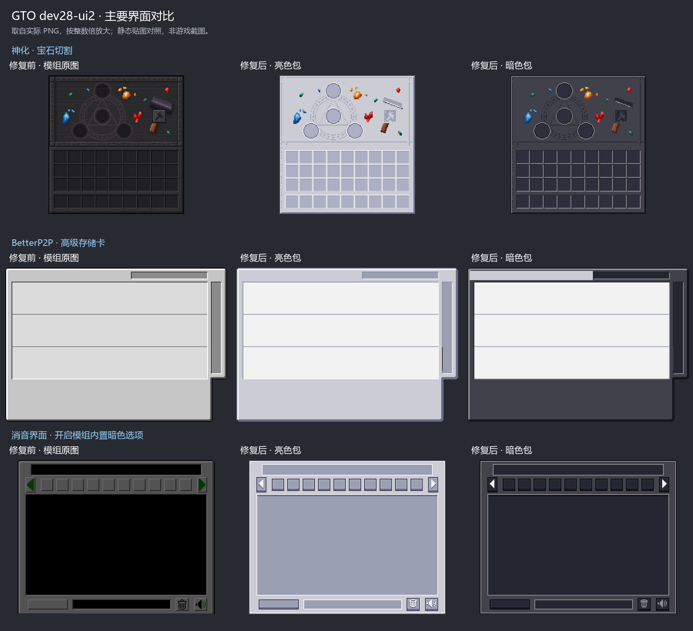
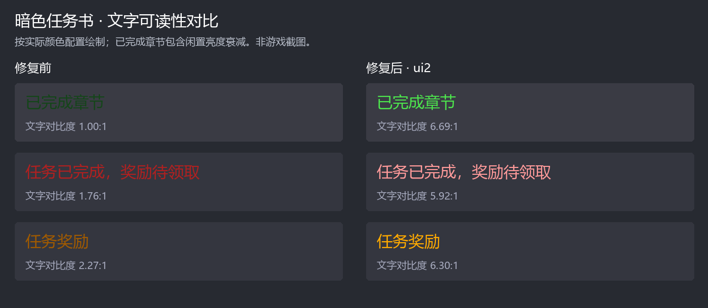

# GTO 0.6.0-dev28 适配

亮色、暗色两个版本同步更新，资源包版本为 `1.20.1-gto-dev28-ui2`，打包文件标为 `dev28-ui2`。

## ui2 主要问题修复

- 暗色任务书：将内置亮色模式下的完成章节改为亮绿、待领奖励提示改为浅红、奖励标题改为金色；闲置章节亮度由 65% 调至 90%，保留悬停/选中的亮度区别。对应文字在实际深色背景上的静态对比度均超过 4.5:1。
- 神化 `7.4.8`：补齐 `augmenting`、`reforge`、`gem_cutting`、`library`、`salvage` 五个实际界面、`socket` 提示轮廓及 `reforge_animation` 重铸动画。保留原图尺寸、UV 和透明度，背包格复用现有 AE 槽位贴图；神化自己绘制亮色字的区域保留深底。
- BetterP2P `1.5.0`：补齐高级存储卡图集。该版本将标题、设备列表文字写死为 `#404040`，暗色版采用深色外框和浅色文字区域，避免黑字落在深底上。名称区域悬停时还会叠加固定黑色遮罩；提亮列表底色后，普通名称悬停对比度由原图的约 2.52:1 提至 3.00:1，仍需模组代码配合才能彻底解决。本包不修改模组代码。
- Extreme Sound Muffler `3.51`：补齐 `sm_gui_dark.png`，与已适配的 `sm_gui.png` 使用同一套主题。切换模组自己的暗色选项后也继续应用所选资源包配色。
- 两套包各新增九张 PNG；新增神化、BetterP2P 贴图的来源与相应许可记录在包内 `CREDITS.txt`、`licenses/`。

本轮按主要问题范围修复；Ad Astra、Ars Nouveau 等其他模组的主题覆盖缺口，以及可选 AE2CS 动画和历史无效路径尚未处理。

## 静态对照

主要界面从左至右为模组原图、亮色包、暗色包；任务书按实际配置颜色绘制。这些是静态对照，尚未进行游戏内验证。

## 改动

- 补齐抽入卡的过滤按钮，将抽入卡、抽出卡的两行配置槽及其背景上移 9 像素，与模组当前布局对齐，为过滤按钮留出空间。
- 补齐样板编码终端的 `modePanel4`、`modePanel5` 位置，沿用主题中其他模式面板的位置；无线样板编码终端继承这项适配。
- 为机器界面的托盘和卡片按下状态补齐主题色，同时覆盖 `default`、`midnight` 配色。
- 补齐 EMI 配方参数区的棋盘格和整行底色，暗色使用深灰底、亮色使用灰蓝底。[GTM PR #81](https://github.com/GregTech-Odyssey/GregTech-Modern/pull/81) 已合并三个配色键的接入；dev28 自带的 GTM `26.11.17` 不支持这些键，需要更新到包含该修复的 GTM，仅替换资源包无法消除参数区亮底。
- 为任务书补齐亮色模式的帮助按键、帮助说明配色；暗色包在切换任务书内置亮色模式时也保持自身主题。
- 更新资源包描述、署名文件中的适配版本及发行版本号。
- 移除 Building Gadgets 2 创造模式建筑胶容器贴图中损坏的重复 ICC 元数据块，保留全部图像数据；删除暗色包 FullEng 目录下五个零字节贴图。

保留已有的 CPU 三档高度、状态过滤和手动置顶图标，以及合成材料搜索框与二合一终端适配。

## 核对基准

以本地 GTO `0.6.0-dev28` 实例实际安装的文件为准：

| 模组 | 版本 |
| --- | --- |
| AE2 GTO | `15.2611.7` |
| ExtendedAE | `1.26.1103` |
| GTOCore | `26.11.5` |
| GTCEu | `26.11.17` |
| AE2WTLib | `15.3.3` |
| AE2 Insert Export Card | `1.3.0` |

dev26 与 dev28 的 ExtendedAE 界面文件差异主要来自换行；解析后的布局一致。合成状态页保留主题自身已对齐的 CPU 列表及工具栏坐标。

网络工具箱由 AE2 的界面加载器在缺少配置时补入，使用材质包已覆盖的背景，无需增加重复引用。新增小游戏素材保持模组原样。

## 验证与限制

已通过静态检查：亮色包 2780 个 JSON/材质元数据文件、3483 张 PNG，暗色包 2804 个 JSON/材质元数据文件、3455 张 PNG；两套各 110 份直接覆盖的在用界面配置的继承与必要控件齐全。新增神化与 BetterP2P 贴图尺寸、透明度与安装 jar 的原图一致；消音模组两套图集的 UV 布局一致。已核对槽位坐标、文字对比度，并逐文件校验两个 ZIP 的内容和完整性。预览为贴图静态对比，不是游戏截图。

GTM 配色接入改动已通过 `spotlessCheck` 和 `compileJava`，未发布或替换实例中的 GTM。尚未完成游戏内资源重载与实际界面操作验证。
